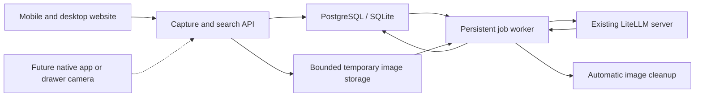

# RemindMe implementation plan

> iOS scope (2026-11-07): native SwiftUI / AVFoundation client in `ios/`, two primary tabs (Scan / Find), auxiliary place and photo-history management, direct result drill-down, persistent per-photo upload and cancellation, shared LAN mode without login. Reuse the existing independent-photo API and PostgreSQL service. See `ios/README.md` for usability decisions, recovery boundaries and build/verification instructions.

Instant-photo ordering (2026-11-07): use the original `captured_at` when selecting an item's newest observation, photo/crop and surviving history, with server sequence as a tie-breaker. Offline uploads and expired-upload replacements may register later than newer photos. Preserve the original capture time on retry and keep unacknowledged originals when expiry or local quota prevents uploading.

Photo orientation (2026-11-07): use the camera's gravity-based rotation and normalize EXIF before upload. The existing recognition request also returns a clockwise quarter-turn per photo, based on readable text/object orientation rather than aspect ratio. Keep boxes in the supplied-image coordinate system, then rotate previews, actual crop pixels and boxes together at commit. Ambiguous scenes remain unchanged. Version media URLs when processing updates images so clients reload corrected previews. Existing retained history can be corrected with `server/scripts/reorient-history.mjs` without changing inventory or recognition results.

> Current scope (2026-11-06): four flat pages — Scan, Find, Places, History. Scan and Find are the main workflows. Hide the upstream household/area/bin hierarchy and legacy inventory tools. A place is a directly named storage spot; preserve existing IDs and records internally. Production runs in a dedicated database on Tomubuntu’s existing PostgreSQL service. Local PostgreSQL is used for testing; SQLite remains supported for compatibility and archived snapshots.

Scope update — instant scanning: the camera button opens the system camera synchronously within the user gesture. Each returned photo becomes an independent `web-instant` capture, is saved and submitted automatically, and can be cancelled while the scanner remains usable for the next photo. Do not require explicit start-batch or finish-upload actions. Persist cancellation intent across offline sessions; server-side cancellation invalidates leases, rejects late uploads/completion, and retracts exclusive evidence. A cancellation arriving before creation leaves an authorized tombstone. Instant captures contribute independently even when processed out of order: preserve newer per-item information while retaining older observations and unique items. Missing objects in a subsequent photo are retained. Find results support item soft-delete with undo.

Production/test separation: Tomubuntu runs the dedicated production PostgreSQL database; local PostgreSQL holds testing data. Future deployments preserve the production records created since its initial reset.

Date: 2026-11-06

Build a self-hosted household item finder from OpenBin. The first version uses a mobile-friendly website: select a storage location, take or upload multiple photos, and automatically update the recorded contents through the owner's LiteLLM server. Original photos are temporary processing inputs; compressed history previews and item crops remain available. The product must not require reviewing or approving AI results.

Scope update, 2026-11-06: run on the Mac LAN with a shared local profile and no login/registration. Add photo-grouped recognition history, clickable item details with real photo crops, and removal of an individual photo record. Removing a record retracts its exclusive recognition results; items supported by other records remain. This replaces the earlier requirement to discard all derived images.

## Agreed scope

- Web application first, usable from Safari on an iPhone 14 and from a desktop browser.
- Deploy the application, database, and temporary photo storage on the home server.
- Connect to the owner's existing LiteLLM endpoint using the OpenAI-compatible API.
- Represent each drawer, box, or shelf as a named storage location.
- Support roughly 10–20 photos in one capture batch; validate the exact limit against the selected vision model.
- Automatically validate and apply successful recognition results. No pending-confirmation state, approval screen, or manual review queue.
- Delete original inputs and request staging after successful processing. Retain bounded compressed photo previews and item crops alongside structured records until the user removes the photo record.
- Bound storage for failed jobs and incomplete uploads with quotas and expiry.
- Keep the ingestion interface suitable for a future native uploader and drawer camera module. Those clients are outside the first implementation.

The project directory is `/Users/tangt4/Projects/llm/remindme`. It currently contains this plan, with no application checkout or Git repository. Implementation should use this directory as the primary checkout and follow the parent `AGENTS.md` working-directory policy.

## Starting point

Use [OpenBin](https://github.com/akifbayram/openbin) as the application base. The architecture assessment used commit `7ffc01a086c8d8c52afcb8db2faed50b93a3d3d5`; select and pin the implementation baseline before importing it into this directory. Preserve its license and required notices.

Reuse its React/TypeScript frontend, Express backend, authentication, locations, search, database migrations, and self-hosted deployment. Support PostgreSQL on the existing home server database service, with SQLite retained for local use and a bounded temporary photo directory.

The existing photo workflow needs substantive changes:

| Existing behavior | Required change |
| --- | --- |
| Photos belong directly to a bin | Introduce capture batches so different dates are never mixed into one observation |
| Analysis streams back to the active browser request | Run a persistent server-side job after upload completes |
| Accepting an AI list deletes and recreates item records | Update matching records while preserving stable IDs |
| AI suggestions require an Apply action | Validate and commit automatically |
| Photos are retained as bin attachments | Use bounded temporary storage and automatic cleanup |

## User workflow

1. Create or select a location such as `Study / Cabinet / Drawer A`.
2. Start a capture batch while connected to the server, obtain its sequence, then take or select multiple photos. Provide one overall view plus detail views where useful.
3. Tap **Finish capture**. The browser uploads photos and displays progress for this batch.
4. Once the server confirms it has received the complete batch, display **Uploaded — processing in the background**. The user may then leave the page or lock the phone.
5. The server recognizes the batch, reconciles it with previous observations, and writes valid results automatically.
6. Search later by item name, description, or alias. Return the recorded location, last-seen time, and quantity when known.
7. Review history grouped by individual photo, including recognition status and only that photo's results. Click an item for its actual cropped image, description and quantity; show an explicit whole-photo or missing-image fallback when localization is unavailable.
8. Remove a photo record with its X control. Retract results only when no other surviving photo supports them. Restore a shared item's latest surviving observation; preserve manual items and newer manual edits. A removal while inference is running must not reappear at commit.

No confirmation is required after step 4. Unknown quantities and ambiguous matches are represented in the data rather than turned into user tasks.

### Web upload boundary

The first version cannot guarantee that unfinished uploads continue after Safari is backgrounded, the phone is locked, or the page is closed. Do not display a safe-to-leave message before the server has acknowledged the entire batch.

Keep an upload manifest and pending photos in a bounded browser-local queue where storage is available. On reopening, reconcile acknowledged photos with the server and resend missing files using the same IDs. Clear browser copies after the server has accepted the complete batch. Browser storage eviction remains possible; show a clear request to reselect missing photos when recovery is impossible.

Server-side processing must continue independently once the batch is accepted, including across page closure and application restarts.

## Architecture



Use one application container initially. The API and background worker can run in the same process, with job state and leases stored in the database. Limit recognition concurrency to one initially. Upload handling must never wait for model inference.

Keep these responsibilities separate in code:

- **Capture ingestion:** batch manifests, photo receipt, checksums, quotas, and completion.
- **Recognition:** model requests, output validation, and retry handling.
- **Reconciliation:** match observed items, calculate changes, and commit inventory transactions.
- **Cleanup:** remove image files after success or expiry and recover interrupted deletions.

## Data model

Reuse existing location/bin records and add the following concepts through migrations:

| Entity | Required information |
| --- | --- |
| `capture_batches` | Stable client-generated ID, location, source/device, capture time, server sequence, expected photo manifest, state, expiry |
| `capture_photos` | Stable photo ID, batch ID, order, checksum, temporary path, byte size, received/deleted timestamps |
| `analysis_jobs` | Batch ID, analysis version, state, attempt count, next attempt, lease, error category, model alias |
| `observations` | Batch ID, recognized name/description, optional quantity, matched item ID, evidence references to photo IDs |
| `capture_photo_history` | Per-photo preview JPEG, dimensions and dismissal timestamp |
| `observation_photos` | Per-observation photo evidence, normalized bounding box and optional actual crop JPEG |
| `capture_item_baselines` | Pre-recognition snapshot for restoring manually-created item metadata |
| Existing item records | Stable ID, normalized name, aliases, description, last-seen batch/time, latest observation state |
| Location revision | Version used to reject stale inventory commits |

Evidence references identify which input supported a result; they do not imply that the image remains available. Store validated structured output, model/prompt version, and bounded text diagnostics. Never retain image bytes or base64 in JSON fields, logs, or error records.

A stable item record represents a distinguishable item or a group of indistinguishable items at a location. It does not establish physical identity for two identical cables across different drawers.

## Capture API and processing lifecycle

Proposed application endpoints:

| Endpoint | Purpose |
| --- | --- |
| `POST /api/captures` | Create or recover a batch using its client-generated ID; allocate its location sequence before capture begins |
| `PUT /api/captures/:id/photos/:photoId` | Receive one photo idempotently and verify checksum/size |
| `POST /api/captures/:id/complete` | Submit the final photo manifest; seal only when all declared photos are present and enqueue exactly one analysis job |
| `GET /api/captures/:id` | Return upload, processing, completion, failure, and cleanup status |
| Existing location/search APIs | Return automatically maintained inventory and last-seen information |

Use `(capture_id, photo_id)` as the upload uniqueness key. Repeating the same ID and checksum returns the existing acknowledgement; conflicting content returns an error. Reserve disk capacity before accepting file data. Freeze the manifest at successful completion; retries must reference the same photo set.

Use `(capture_id, analysis_version)` as the job uniqueness key. A completed batch cannot be applied twice. A client crash, duplicate completion request, or worker retry must not add another item or increment its count.

The lifecycle is:

```text
uploading → queued → processing → applied → images deleted
                         └→ superseded → images deleted
                         └→ retry scheduled → processing
                         └→ failed → images deleted by expiry
uploading → expired → images deleted
```

The worker claims jobs using a lease. After a restart, reclaim expired leases, retry eligible jobs, and finish pending cleanup. Keep model calls outside database transactions; use a short transaction to commit observations, inventory changes, the location revision, and the successful job state together.

## Recognition and automatic update rules

### Multiple views and duplicate items

- Analyze the photos as one capture batch. Never independently add the item list from each photo to inventory.
- Start with one joint vision request for the complete batch. Verify that the selected LiteLLM model supports the required image count and output size. Reject unsupported batches explicitly; never silently truncate them to OpenBin's existing five-photo default.
- Use the overall view to establish separate visible objects and detail views to enrich identification. The model should associate repeated appearances with one result and return supporting photo IDs.
- Aggregate indistinguishable items by type/description. Store uncertain quantities as `null`; do not substitute `0` or `1`.
- Exact file hashes prevent duplicate uploads. They do not identify the same physical object from different angles.
- Visual deduplication is probabilistic. Measure it on representative drawers; do not describe it as guaranteed.

If a model cannot handle a full batch, choose a compatible model or a tested lower UI limit for the initial release. Splitting recognition across calls requires a separate cross-group reconciliation step and must not result in concatenating independent item lists.

### Automatic reconciliation

1. Validate the structured model response, photo references, quantities, and referenced existing item IDs.
2. Match distinctive attributes and existing location-scoped records. Preserve IDs for matched records. Ambiguous appearances must not be forced into a claimed physical identity.
3. Add newly observed items and update the last-seen fields of matched records. Quantities describe this observation; they are not increments to the previous quantity.
4. Mark previously recorded items that are absent from the new observation as `not_seen_in_latest_capture`. Preserve their last-known location and timestamp. Missing visibility is not proof of removal.
5. Commit automatically in a transaction. Search should distinguish a recent observation from an older last-known location using plain wording, without asking the user to confirm it.

For example: `USB-C cable — Drawer A — last seen 6 Nov; quantity unknown` is a complete result, not a pending-review task.

Invalid or unusable responses receive bounded automatic retries. After final failure, leave the previous inventory unchanged, record the failed scan, and expire its images. Do not create an approval queue.

### Ordering and concurrent captures

In v1, register a capture online before taking photos and assign a per-location server sequence at that point. Retries and browser recovery must reuse that capture ID and sequence; never automatically register an interrupted old batch as a new capture. Starting an entirely new capture offline is outside v1.

Process ready batches in sequence order where possible, without waiting indefinitely for an incomplete earlier upload. At commit, check both the location revision and its latest applied capture sequence. A lower-sequence batch arriving or finishing late becomes `superseded`: retain its structured observation, leave current inventory unchanged, and clean up its images. This makes retries and delayed uploads independent of arrival order.

Store capture and receipt timestamps separately for display and diagnostics. Before adding independently operating camera devices, define device-event ordering and cross-device clock handling; do not assume a late registration timestamp makes an old camera event current.

## Image retention and disk limits

Treat original uploaded images as temporary. Retain separately bounded history previews and item crops in PostgreSQL BYTEA or SQLite BLOB columns, not ordinary bin attachments or JSON fields.

- On success: validate the result, create item crops using model-provided normalized boxes, and commit observations plus retained image BLOBs atomically. Then immediately delete originals and request staging files. Mark original cleanup complete only after deletion succeeds.
- Retained preview maximum: 960 px longest side and 256 KiB. Retained crop maximum: 512 px longest side and 128 KiB. Bound total derived image storage (default 512 MiB) and per-batch crop preparation memory (32 MiB). At capacity, retain text results and show missing-image fallback rather than silently evicting older evidence.
- Deleting a photo history record clears its preview and crops atomically with retracting exclusive observations and updating inventory. Database space becomes reusable; old backup copies are not automatically scrubbed.
- On deletion failure: persist a cleanup task and retry; a restart must not strand images indefinitely.
- On explicit cancellation: invalidate the job lease and abort active inference, retract evidence atomically, and clean originals as soon as active uploads/readers release them. On model failure or incomplete upload: retain inputs only for a bounded retry/expiry period, then delete them and keep a small failure record.
- Run a startup and periodic sweeper for expired batches, orphaned files, and incomplete cleanup.
- Count uploading, queued, processing, and cleanup-pending files against one shared scratch-space quota, including transformation overhead.
- When the quota or minimum-free-disk threshold is reached, reject or pause new uploads. Never silently remove active inputs to make room.
- Exclude scratch originals from backups. Back up the database (including retained previews/crops) and configuration; restored jobs whose input files are absent become failed/expired rather than pretending they can resume.
- Disable image-bearing request/response logging for this application in both the app and the relevant LiteLLM logging configuration. Audit proxy logs and caches for retained image payloads.

Initial configurable defaults to validate on the home server:

| Setting | Initial value |
| --- | --- |
| Photos per batch | 20, subject to model compatibility testing |
| Image size | 5 MiB maximum per uploaded image |
| Recognition concurrency | 1 |
| Scratch image quota | 512 MiB, with reserved transformation headroom |
| Incomplete upload expiry | 1 hour |
| Failed batch expiry | 1 hour after final failure |
| Additional model attempts | 2 |

An expiry or disk-pressure cancellation must first stop active readers/workers before deleting their files. Prefer per-photo retry for small files; do not assume the existing server supports byte-range resumable uploads.

Old scans from before history-image retention cannot regain their deleted photos. Keep their structured results with an explicit missing-image state. New scans can be visually reviewed using retained previews and crops, while the original full-resolution inputs remain deleted.

## LiteLLM and home deployment

Example environment values when the app can resolve `litellm` on the same Docker network:

```dotenv
SELF_HOSTED=true
AI_PROVIDER=openai-compatible
AI_ENDPOINT_URL=http://litellm:4000/v1
AI_API_KEY=<application-specific-litellm-key>
AI_MODEL=home-vision
```

`home-vision` is an alias configured on the owner's gateway. Use the gateway's actual reachable address in deployment. Test image input, multiple images, structured results, timeouts, and failure behavior against that alias before selecting the final batch limit.

Keep gateway credentials on the server. Publish the web app through HTTPS trusted by the iPhone so in-page camera capture works. Use a dedicated PostgreSQL database and application role on the shared server (or keep SQLite on local disk), keep temporary images in a separately bounded directory, and expose application health and job status.

Storage is local to the home server. The inference destination depends on the providers configured behind LiteLLM.

## Implementation sequence

### 1. Establish the application baseline

Import a pinned OpenBin baseline into this directory, retain upstream history/license as appropriate, and document build/run commands. Verify the unmodified app starts with persistent SQLite storage and can call the configured LiteLLM vision alias. Use test images to establish a supported 10–20-photo batch size.

### 2. Build capture storage and ingestion

Add migrations, batch manifests, idempotent photo upload, capacity reservation, batch completion, expiry, and cleanup. Verify that incomplete batches never start recognition and duplicate requests never create new jobs.

### 3. Implement durable recognition and automatic application

Add the worker, leases, model-output schema, automatic reconciliation, stable item updates, revision checks, and transactional commit. Remove the existing AI Apply/confirmation step from the new workflow. Wire successful commits and terminal failures into cleanup.

### 4. Build the mobile web workflow

Implement location selection, continuous photo capture/file selection, batch previews, upload progress, interrupted-upload recovery, and server-side processing status. Normalize orientation and image formats; test iPhone camera captures and photo-library selections, including HEIC conversion or an explicit supported-format fallback. Show when it is safe to leave the page. Expose updated inventory automatically through search and location views.

### 5. Validate retention and deploy

Test failure recovery, quota exhaustion, restart behavior, original-input cleanup, retained preview/crop access, and removal of photo records with shared evidence. Validate the actual iPhone 14 experience. Home-server deployment remains a later step; the active build runs locally on the Mac LAN.

## Acceptance checks

- A complete batch of 10–20 photos creates one automatic inventory update without an Apply or Confirm action.
- Two views of the same distinctive object do not become two entries in the test fixtures; two simultaneously visible separate objects remain distinguishable. Ambiguous identical cables can return an unknown quantity.
- Re-uploading a file, retrying completion, or rerunning a worker does not duplicate items or increase counts.
- Missing files keep a batch in uploading state; no partial inventory is written.
- Once the server acknowledges the full batch, closing Safari does not stop processing.
- Locking Safari before upload completion never produces a false success message; reopening can recover or clearly identify missing inputs.
- Existing matched items retain their IDs. Older captures cannot overwrite newer applied inventory.
- A previously seen but now occluded item remains searchable by its last-known location without a confirmation task.
- A model timeout, invalid response, or exhausted retry budget leaves the previous inventory intact.
- Successful processing deletes original scratch files while retaining bounded history previews and actual item crops. Failed and abandoned original inputs expire within the configured window.
- Restarting after the inventory commit but before deletion finishes cleanup without reapplying the result.
- Quota tests include simultaneous uploads, resizing overhead, failed jobs, and cleanup failures; the reserved scratch budget is not exceeded.
- App and LiteLLM logs do not retain image payloads; API image responses disable caching. Database backups deliberately include retained history previews and crops, but exclude scratch originals.
- Post-deletion searches still return useful item descriptions, locations, and last-seen timestamps.

## Future camera integration

Give every capture a source, device ID, location, event ID, and timestamp from the start. A drawer camera can later submit the same batch manifest and photos without a separate inventory system.

An opening event should start a capture session. Capture stable, unobstructed views during use and select a valid view after the last visible interaction, before the drawer becomes hidden or dark. An opening-only snapshot records the pre-use state. If no usable final view exists, keep the previous inventory rather than applying an empty observation.

Camera-side event debouncing, local retry buffers, and device sequencing belong to that later integration. A native iPhone uploader can also reuse the capture API when reliable system-managed background upload becomes the next priority.

## Reference implementation points

- [OpenBin deployment](https://github.com/akifbayram/openbin/blob/7ffc01a086c8d8c52afcb8db2faed50b93a3d3d5/Dockerfile)
- [OpenBin database schema](https://github.com/akifbayram/openbin/blob/7ffc01a086c8d8c52afcb8db2faed50b93a3d3d5/server/schema.sqlite.sql)
- [Current item replacement logic](https://github.com/akifbayram/openbin/blob/7ffc01a086c8d8c52afcb8db2faed50b93a3d3d5/server/src/lib/binUpdateHelpers.ts#L63)
- [Current analysis lifecycle](https://github.com/akifbayram/openbin/blob/7ffc01a086c8d8c52afcb8db2faed50b93a3d3d5/server/src/lib/aiStream.ts)
- [OpenAI-compatible provider configuration](https://github.com/akifbayram/openbin/blob/7ffc01a086c8d8c52afcb8db2faed50b93a3d3d5/server/src/lib/sdkProviderFactory.ts)
- [LiteLLM vision input](https://docs.litellm.ai/docs/completion/vision)
- [LiteLLM structured output](https://docs.litellm.ai/docs/completion/json_mode)
- [Safari camera capture requirements](https://webkit.org/blog/7763/a-closer-look-into-webrtc/)


### 语音输入（iOS 1.0.8）

- 查找页麦克风：Apple Speech 中文转文字后直接搜索，保留文字校正和键盘输入。
- 物品详情「语音补充」：将裁剪图（缺失时原预览）、当前名称/说明与转写文字一起提交现有 LiteLLM 视觉模型，一次更新名称、说明、别名；数量、地点、最后拍摄时间不变。
- 搜索与识别结果使用同一个物品身份；已有结果同步修正。失败保留原值，更新过程中删除的记录不恢复。
- 首次申请系统麦克风与语音识别权限，支持时本机识别；不持久化音频，不向 LiteLLM 上传音频。
